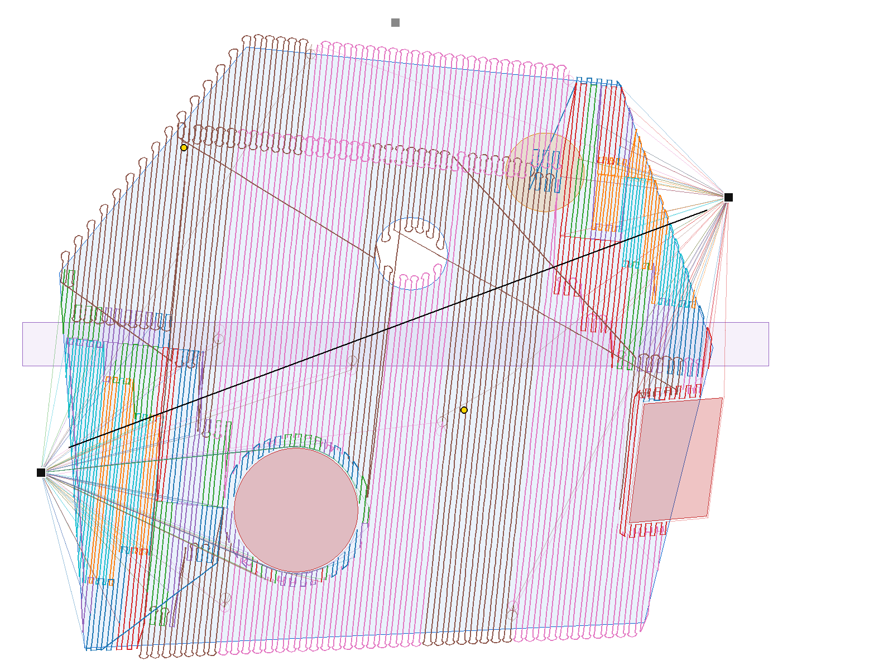
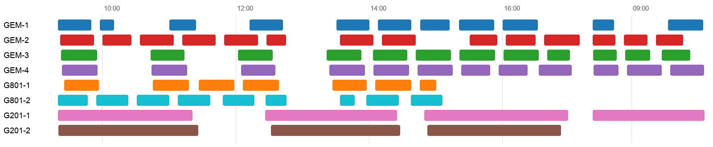

# Geoscan Fleet Planner

Сервис планирования и распределения авиационных работ группы БВС. ЛЦТ, задача 5, заказчик — ГК «Геоскан».

По области съемки, запретным зонам, высотным препятствиям, площадкам и составу парка (Геоскан 201, Gemini, 801) сервис строит индивидуальные полетные задания для каждого борта:
- маршрут и ключевые точки;
- высоты AMSL и AGL, скорости;
- места взлета и посадки;
- этапы полета;
- расписание вылетов.

Задания экспортируются в **KML / GeoJSON / QGroundControl .plan**. Поддерживаются два критерия оптимизации: **минимум времени выполнения** и **минимум суммарного налета**.

## Главное

| | |
|---|---|
| Сетка галсов | Высота, шаг и базис считаются по GSD, камере и перекрытиям (70/50% по умолчанию). Высота над землей постоянная: рельеф берется из ЦМР с шагом 25 м |
| Ветер | По методике QA-сессии: 1) предел по ТТХ на рабочей высоте (профиль ветра по высоте); 2) выбор курса галсов (снос кадра у самолета). Путевая скорость постоянна, на расход АКБ ветер не влияет. Для консервативной оценки — физическая модель (треугольник скоростей) |
| Распределение | **Байесовская оптимизация** (TPE) долей, ширины нарезки и размера ячеек с теплым стартом от сетки. Эвристический поиск с полным построением финальных кандидатов. Несколько вылетов на борт, **резерв АКБ не менее 20%**, зарядка, переезды расчета, светлое время суток |
| Безопасность | Эшелоны и разведение задержкой старта. **Независимый crash-тест** выходной траектории: непрерывные сближения и пересечения отрезков с зонами/препятствиями; высоты, энергия, ветер, свет, расписание, площадки, АКБ и срок. Провал проверки запрещает статус `ok` |
| Воздушное пространство | С планом полета (коридор до 700 м, как на QA) или **без плана полета по ФП ИВП**: потолок 150 м, прямая видимость, без самолета; рекомендация площадок для покрытия кругами видимости |
| Подбор парка к сроку | Ответ организаторов: пользователь задает срок или число бортов и получает подсказку. Кривая «время работ от числа бортов», минимальный парк в срок, а если доступного мало — сколько бортов потребуется (`POST /api/advise`) |
| Данные организаторов | Задание «Границы полетов.kml» (613 участков, без площадок — площадки расставляются автоматически), зоны «Московская зона.kml» (высоты из текста, [предложенный формат](docs/ZONE_FORMAT.md) высот и времени действия), 3D-препятствия — загружаются как есть. Ресурс до ТО по регламенту организаторов (201 — 80 полетов, 801 — 160 ч) |
| Невыполнимость | Причина и конкретная рекомендация: «добавьте площадку около (…)», «назначьте Геоскан 201», «увеличьте GSD до ≥ …» |
| Энергия | Линейная модель (QA) либо экспериментальная модель по открытой телеметрии других аппаратов. Точность переноса на Геоскан не измерена; ограничения авторских метрик — в [ENERGY_MODEL.md](docs/ENERGY_MODEL.md) |
| Полетные задания | Для каждого борта: KML/GeoJSON, QGroundControl `.plan` по вылетам и **задание для печати** — схема маршрута, профиль высот, этапы со временем, ключевые точки с координатами |
| Интерфейс | Ход расчета с графиком сходимости оптимизатора и отменой; инспектор вылета с профилем высот (курсор по профилю двигает борт на карте); точки crash-теста на карте; раскраска по бортам, типам или этапам; сравнение критериев с дельтами; история с восстановлением сценария и параметров; анимация и диаграмма Ганта; светлая и темная темы; горячие клавиши |
| Бонусы | Рекомендация оптимальных площадок (применяется в один клик), экспорт в QGroundControl, REST API со Swagger |

Проверено 25.09.2026: демо «Токсово, 100 км²», 8 бортов (2×201, 4×Gemini, 2×801), ветер 5 м/с, 3D/4D-зоны, реальная ЦМР Terrarium z12, старт 25.09.2026 09:00 МСК, TPE/normal, линейная энергия, ветер QA.

| Критерий | Время работ | Налет | Вылетов | Покрытие разрешенной площади | Crash-тест |
|---|---|---|---|---|---|
| Минимум времени | **7.64 ч** (1 рабочий день) | 34.59 ч | 55 | 99.83% | 8/8 |
| Минимум налета | 25.81 ч | **17.91 ч** | 16 | 99.83% | 8/8 |

Полная запрошенная площадь — 102.272 км²; покрытие всей площади — 94.41%, разрешенной — 99.83%. Расчет занял 20.5/13.0 с на машине аудита с готовым кэшем ЦМР. Воспроизведение: `python scripts/audit_benchmark.py --terrain --effort normal --optimizer bayes`.

Ниже — исторические результаты авторов для других демонстраций; после исправлений аудита они не пересчитаны:

Демо «Артем, Приморье» на **реальных высотных препятствиях из примера организаторов** (1082 объекта eTOD, абсолютные отметки, рельеф): 6.4 ч, 39 вылетов, покрытие разрешенной площади 99.9%, crash-тест 7/7. Файл препятствий организаторов можно загрузить и отдельным слоем поверх любой области.

Демо «Трубопровод 35 км + 2 узла» (коридор с поворотами разбивается на прямые участки со своим курсом галсов): 4.1 ч, налет 16.3 ч, 28 вылетов, crash-тест 7/7.

Демо «Задание организаторов: Московская обл.» — второй пакет файлов как есть: 613 участков (245 км², 65×58 км) без площадок, 341 зона ограничений (у района 17), 5146 препятствий (у района 1837). 28 площадок расставлены автоматически, crash-тест 7/7, покрытие 99.7%, расчет ~8 мин в режиме «быстро».

Актуальные тесты и раздельные числа выполнимых планов, отказов и нарушений — в [отчете аудита](docs/AUDIT_2026-09-25.md). Исторические результаты масштабирования — в [docs/BENCHMARK.md](docs/BENCHMARK.md).




## Быстрый старт

```bash
docker compose up --build
```

Затем откройте http://localhost:8000 (интерфейс) и http://localhost:8000/docs (Swagger).

Без Docker (проверено на Python 3.11):

```bash
python -m venv .venv && .venv/bin/pip install -r requirements-dev.txt
.venv/bin/uvicorn api.app:app --port 8000
```

Windows PowerShell:

```powershell
py -3.11 -m venv .venv
.\.venv\Scripts\python.exe -m pip install -r requirements-dev.txt
.\.venv\Scripts\python.exe -m uvicorn api.app:app --port 8000
```

Консольный режим:

```bash
.venv/bin/python -m planner.cli scenarios/demo_toksovo.geojson --fleet geoscan_201=2,geoscan_gemini=4,geoscan_801=2 --objective time --start 2026-09-25T09:00:00+03:00 --wind 5 --wind-dir 250 --out out/
```

Тесты, стресс-тест и бенчмарк:

```bash
.venv/bin/python -m pytest -q tests
```

```bash
.venv/bin/python scripts/stress.py 40 7
```

```bash
.venv/bin/python scripts/bench.py
```

## Документация

- [docs/ARCHITECTURE.md](docs/ARCHITECTURE.md) — архитектура и модули
- [docs/ALGORITHM.md](docs/ALGORITHM.md) — алгоритм оптимизации, математическое обоснование, сложность
- [docs/API.md](docs/API.md) — REST API, форматы входа и выхода
- [docs/USER_GUIDE.md](docs/USER_GUIDE.md) — руководство пользователя
- [docs/LIMITATIONS.md](docs/LIMITATIONS.md) — известные ограничения и допущения
- [docs/BENCHMARK.md](docs/BENCHMARK.md) — бенчмарк масштабирования
- [docs/BENCHMARK_BO.md](docs/BENCHMARK_BO.md) — сетка против байесовской оптимизации
- [docs/ZONE_FORMAT.md](docs/ZONE_FORMAT.md) — предложенный формат высот и времени действия зон ограничений; как читается формат организаторов
- [docs/AIRSPACE_MODES.md](docs/AIRSPACE_MODES.md) — режимы воздушного пространства: с планом полета (до 700 м) и без плана полета по ФП ИВП (до 150 м, прямая видимость)
- [docs/ENERGY_MODEL.md](docs/ENERGY_MODEL.md) — модель расхода АКБ, откалиброванная по открытой телеметрии (ML)
- [docs/Geoscan_Fleet_Planner.pptx](docs/Geoscan_Fleet_Planner.pptx) — презентация для защиты
